# Evidence Change Sentinel


**Project citation:** [Francisco Angulo de Lafuente](https://orcid.org/0009-0001-1634-7063) · [CITATION.cff](CITATION.cff) · [Software metadata](codemeta.json).


**When a funding call changes, Evidence Change Sentinel finds which assessments the change affects, quotes the evidence, keeps the rest intact and sends anything uncertain to a person.**

<!-- impact-note:start -->
<sub><strong>Efficiency and practical value.</strong> Evidence Change Sentinel tracks which source changes affect an assessment and reuses unaffected results only when their evidence fingerprints still match. This targets repeated review work while preserving quotations, provenance and a human-review path for uncertainty. The <a href="#what-the-workflow-actually-does">documented workflow</a> demonstrates selective reassessment on controlled synthetic cases, giving future real-document evaluations a precise mechanism to test.</sub>
<!-- impact-note:end -->

## Results at a glance

| What was shown | Result | Evidence |
|---|---|---|
| Connected run on the sponsor stack, 23 October 2026 | Zetaris SQL, Meterless Nightshift and H-MEM end to end on a controlled synthetic call: 3 of 3 requirements validated, the 1 affected decision changed correctly, the 2 unaffected assessments preserved from memory, 4 local model calls, 0 abstentions | [Run record](evidence/live-feature-20261023.json) · [acceptance](evidence/live-acceptance.json) |
| Signed provider receipts | 4 of 4 Ed25519 envelopes verified | [Verification](evidence/signature-verification-20261023.json) |
| Local inference | Llama 3.2 1B fully on an RTX 3090 through CUDA | [Placement record](evidence/nvidia-local-20261023.json) |
| Controlled evaluation | 55 of 55 synthetic cases correct, unaffected criteria preserved | `npm run evaluate` |
| Application tests | 31 of 31 pass | `npm test` |
| H-MEM conformance | 13 of 13 checks pass | `npm run conformance` |
| Dependencies | 0 known vulnerabilities | `npm audit --omit=dev` |
| Delivery | Submitted to the Open Agent Hackathon 2026, Track 02, on 23 October 2026 at 07:06:59 UTC, ID `01a16795-98e3-765a-a05d-a699ba45c5f8`, with a narrated 3:41 demonstration and an eight-slide deck | [Receipt](evidence/submission-receipt-20261023.json) |

The tests, conformance checks, evaluation and dependency audit were re-run from a clean checkout on 6 November 2026.

**For judges:** [delivered packet and receipt](docs/FINAL_ACCEPTANCE_AND_SUBMISSION.md), [model versus validator and sponsor roles](docs/MODEL_AND_VALIDATOR.md), [model per request in the captured trace](evidence/model-request-index-20261023.json), and [current service recovery](docs/OPERATIONS.md). The credential-free sample commands below reproduce the deterministic path. The dated connected run is separate evidence; current services are under recovery.


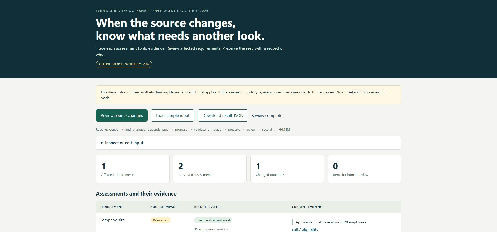

## Run from a clean checkout

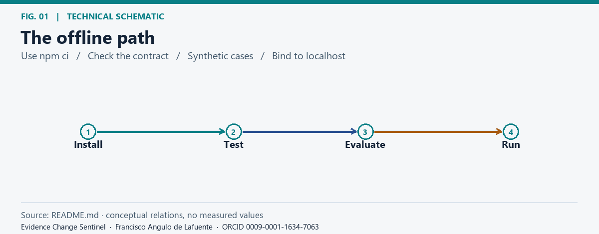

*The offline path.* [Static figure](docs/figures/fig-01.png).


Requires Node.js 22 or later and npm; no Python, GPU, model download or service credentials are needed for sample mode.

```sh
npm ci
npm test
npm run conformance
npm run evaluate
npm start
```

Open `http://127.0.0.1:8788`. Click **Review source changes**. Example 1 changes a company-size limit from 50 to 20: a fictional applicant with 35 staff stops meeting that criterion, while its date and region assessments are preserved. Example 2 has unchanged evidence. Example 3 introduces ambiguous wording and requires human review.

Programmatic execution:

```sh
node --import tsx run.mjs run input_examples/example_1.json output.json
```

HTTP:

```sh
curl -X POST http://127.0.0.1:8788/run \
  -H "Content-Type: application/json" \
  --data-binary @input_examples/example_1.json
```

Three inputs and their actual generated outputs are in `input_examples/` and `output_examples/`. A run writes a factual JSONL execution record under `logs/`. No private internal reasoning or credentials are logged. Inputs are limited to 500 KB over HTTP, 100 requirements and 500 versioned passages.

Optional Docker path (Docker daemon required; **built and HTTP-tested in isolation on 22 October 2026, sample mode only**):

```sh
docker build -t evidence-change-sentinel .
docker run --rm -p 127.0.0.1:8788:8788 evidence-change-sentinel
```

## What the workflow actually does

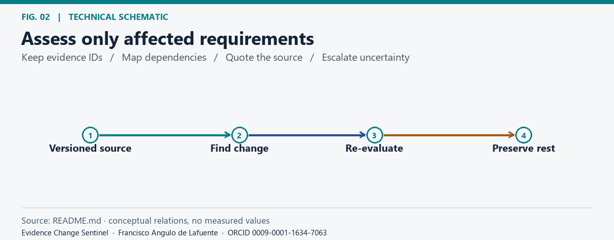

*Assess only affected requirements.* [Static figure](docs/figures/fig-02.png).


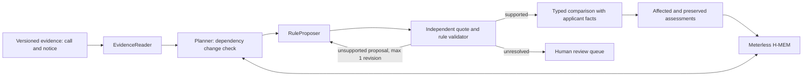

These names are software responsibilities, not claims that several autonomous agents ran in sample mode. The offline proposer interprets a deliberately narrow grammar. The live proposer calls Meterless Runtime; its validator can reject a proposal, request one repair and abstain after two failed attempts. That live loop is covered by mock contract tests and a separate actual authenticated Zetaris/Nightshift run; see `evidence/live-feature-20261023.json`. Structured JSON output constrains syntax and value types; the independent source validator still decides whether a proposal is supported. The run has a five-minute application budget and each model request is capped at the remaining budget, up to 180 seconds. An upstream outage returns an explicit error; it never masquerades as a live successful sample run.

An assessment is tied to source ID, passage ID, exact quotation, source URL and SHA-256 of the passage. Changed applicant facts also invalidate a conclusion. Missing referenced passages and new unmapped clauses trigger review. Changed clauses with unrelated content are not guessed away. No entire document is represented as unchanged simply because one old requirement still matches.

H-MEM stores assessments with provenance, source fingerprints and a mutation ledger. It is the real, unmodified upstream reference, including its deterministic hash embedder and JSON persistence. Reuse requires an exact fingerprint of project, applicant, requirement, text, URL and sample/live mode; semantic similarity alone never authorizes reuse. The CLI starts each run in a fresh memory by default; the library's `persistDir` option enables persistence and is tested across sessions. This prototype is single-process and its JSON persistence is not a concurrent multi-user database.

## Sponsor integration

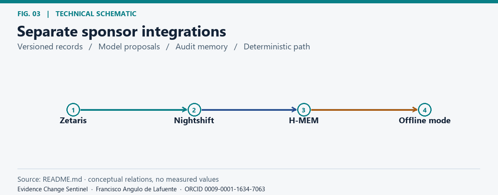

*Separate sponsor integrations.* [Static figure](docs/figures/fig-03.png).


| Technology | Implemented role | Verified status |
|---|---|---|
| Meterless H-MEM | Assessment provenance, exact evidence recall, supersession and ledger | Reference conformance 13/13; application persistence test passes |
| Meterless Nightshift | OpenAI-compatible rule proposals, discovery, authentication and review feedback | Real local Llama 3.2 1B proposals and complete controlled feature pass; signed provider envelopes retained in evidence/live-feature-20261023.json |
| Zetaris | SQL retrieval from one view joining versioned call and notice evidence | Real authenticated SELECT 1 and six versioned view rows verified; see evidence/zetaris-20261022.json |
| Coding tool | Codex created and executed the code | Cursor is optional under the official Build update; see docs/RULE_UPDATE_20261022.md |
| NVIDIA | CUDA acceleration for Nightshift local inference on RTX 3090 | Real lane placement and GPU process verified; no Nemotron special-prize claim |

### Live setup

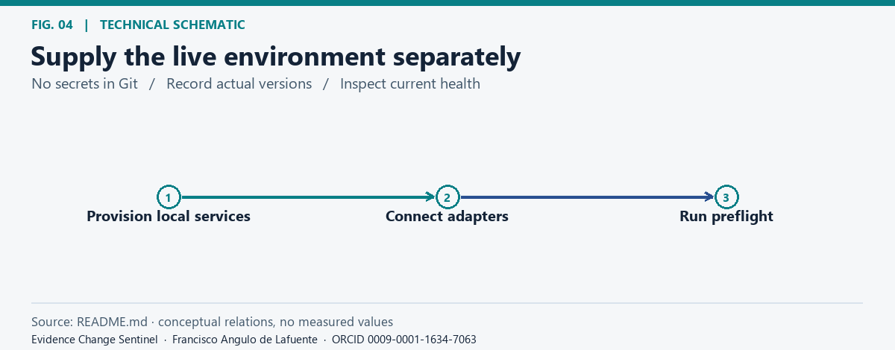

*Supply the live environment separately.* [Static figure](docs/figures/fig-04.png).


Use `.env.example` as a list of variable names; keep credentials in your own local environment. Node 22 can read a private env file:

```sh
node --env-file=.env --import tsx scripts/preflight.mjs
node --env-file=.env --import tsx run.mjs serve
```

For live mode set `SAMPLE_MODE=false`. Supply a Zetaris instance, organisation ID and API key; a Nightshift URL, **real** Runtime token and discovered routing mode. The application does not create accounts, activate paid plans, generate keys, read the Nightshift token file or accept service terms for you. Any NVIDIA key belongs in Nightshift's Providers settings, not in this repository or in a submission.

Zetaris view `sentinel_review.sentinel_passages` must return five string columns in this order:

```sql
SELECT source_id, version, passage_id, passage_text, source_url
FROM sentinel_review.sentinel_passages
```

`version` is `before` or `after`; identities must be unique. Live mode reads these rows from Zetaris rather than trusting the input's sample rows. This view should combine the call and official notices, retain stable passage identifiers and expose both versions. Populate it with public or explicitly synthetic data; keep private applicant data outside the public repository. Fewer than 1000 rows are accepted; this prototype refuses a possibly truncated result. The audited local view unions separate synthetic calls and notices tables. Reproduce it with `docs/zetaris-provision.sql` and `data/zetaris/`, copied to the installation shared path shown in that SQL. It creates new objects and does not replace existing views.

The adapter uses the REST shape in the official 21 October Participant Setup Guide: `POST /api/v1.0/sql-editor/sqls/run`, bearer token, `X-Org-ID`, `X-Request-ID`, `queryId`, `sql`, `source`, `limit`. Meterless implements the [official Runtime provider contract](https://meterless.ai/engines.html): normalized `/v1`, model discovery, bearer authentication, `meterless-app`, `meterless-scope`, and distinct unauthorized/offline errors. `meterless/auto` is a routing mode, not proof that Nemotron executed anything.

Run `npm run preflight` with the configured environment, then an actual live example and verify quotes, traces and the Nightshift model receipt. The 23 October preflight verified both endpoint connections and six Zetaris rows. A separate fail-closed script, `node --env-file=.env --import tsx scripts/live-acceptance.mjs`, demands a real authenticated SQL query, a populated versioned view, Nightshift model discovery, an actual model proposal, evidence validation and H-MEM writes. Mock-backed tests are explicitly distinct from that live check.

## Prototype files and live acceptance


*Historical and current evidence.* [Static figure](docs/figures/fig-05.png).


- [3-minute narrated **offline-prototype** video](deliverables/evidence-change-sentinel-offline-demonstration.mp4), composed of screenshots captured by a real automated browser run on the sample application. The delivered entry uses the connected 3:41 demonstration listed in the results above.
- [8-slide prototype presentation](deliverables/evidence-change-sentinel-prototype.pptx), labelled as an interim deck.
- [Step-by-step sponsor acceptance and HackOS delivery gates](docs/FINAL_ACCEPTANCE_AND_SUBMISSION.md).
- For real authenticated sponsor testing: `npm run preflight` and `npm run live:accept` after loading private credentials, e.g. `node --env-file=.env --import tsx scripts/live-acceptance.mjs`.
- When the code or sample harness reports `mode: "live"` it may still be using **mocked** providers injected by tests. Only authenticated acceptance plus independently inspected sponsor receipts establishes actual Zetaris / Meterless integration.

## Evidence and evaluation

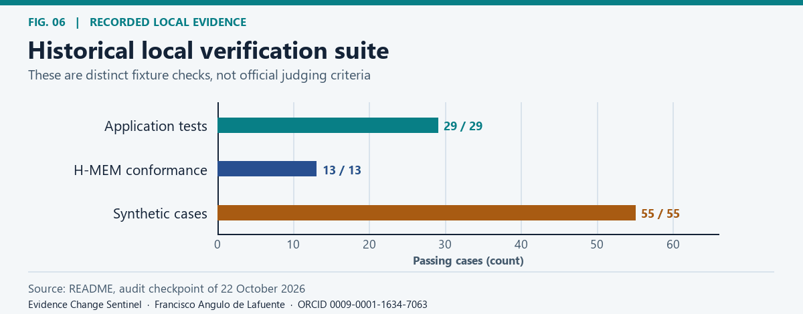

*Historical local verification suite.* [Static figure](docs/figures/fig-06.png).


- 31 application tests: dependency invalidation, missing/added evidence, applicant changes, abstention, invented quotes, source instructions as data, bounded repair, time budgets, failure reporting and H-MEM persistence. Adapter checks use a **local mock service**, never a claimed sponsor endpoint.
- Upstream H-MEM conformance: 13/13 checks.
- `npm run evaluate`: 55 controlled synthetic cases; correct expected outcomes in all 55 and preservation of unaffected criteria. This measures the documented grammar and change propagation only. It is not independent, natural-language, real-world, legal or model-quality validation.
- `evidence/evaluation.json`: every case and its expected/actual label. `evidence/preflight.json`: connectivity record of 23 October. `output_examples/`: actual results. `evidence/demo-screen.png`: browser screenshot of the offline workflow.

## Observations and limits

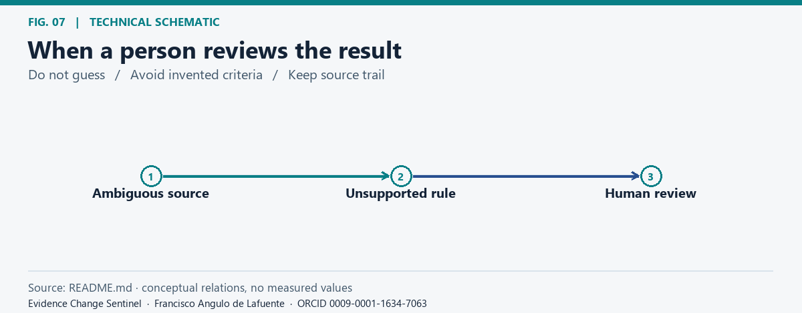

*When a person reviews the result.* [Static figure](docs/figures/fig-07.png).


Only exact English clauses for employee limits, ISO dates and two-letter region lists are automatically interpreted. Unknown wording, exceptions, cross-references, jurisdiction-specific interpretation, time-of-day deadlines and missing facts require human review. Full extraction from arbitrary PDFs, Spanish BOE calls, source crawling, source authority verification and robust segmentation are future work. Source URLs are provenance supplied by the caller; the prototype does not certify their authenticity. Synthetic URLs use `example.org` and are not real funding notices. Adding, removing or changing unmapped passages is detected; silently dropping a requirement from the input contract is not independently detected.

Do not deploy the unauthenticated local HTTP demo to the public Internet. It binds to localhost by default; Docker users should publish only to localhost. Memory/logs are local research artifacts. No automatic application, legal advice or real funding decision is performed.

### Service status and next steps

The connected run above is dated evidence from 23 October 2026. An operational audit on 26 October found the private HackOS panel still showing **Submitted 1/1**, with the original submission ID and materials. The same audit found the Zetaris server backend stopped, and Nightshift 1.2.1 restored without a fresh inference, because the runtime's memory admission protection refused its CPU-lane start. **Next step:** bring both services back and run `npm run live:accept`, following the [recovery notes](docs/OPERATIONS.md). New diagnostics use separate `.state/diagnostics/` directories, so the delivered receipts stay unchanged.

The connected evidence comes from a controlled synthetic call, H-MEM records its provenance, and the offline path is deterministic rather than an autonomous LLM demonstration. **Next step:** the real-document work listed above, starting with PDF extraction and Spanish BOE calls. The receipt evidences delivery; organiser eligibility and judging results have not been published.

## Provenance and rights

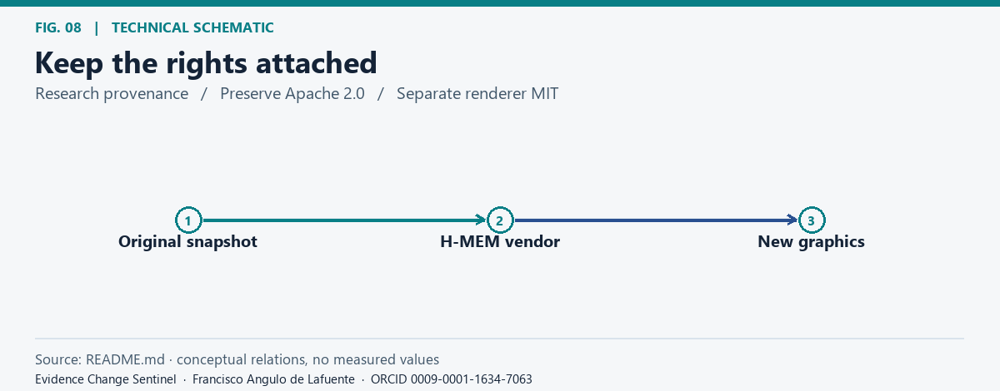

*Keep the rights attached.* [Static figure](docs/figures/fig-08.png).


Project concept, team description and pre-event planning existed before the build window and must be declared. The application source in this snapshot was newly authored on 22 October 2026, after the published build-window opening. No code was copied from other local product projects. Synthetic fixtures were authored for this build.

Meterless H-MEM is a declared pre-existing third-party dependency, vendored from [Meterless/Meterless](https://github.com/Meterless/Meterless) commit `1742dec56a66e58eef9dda2d2b865823758ca8cd`. Its Apache 2.0 licence and provenance are retained under `vendor/hmem/`. tsx and its dependencies retain their package licences. The original application is provided as a research submission snapshot; no additional third-party code rights are implied.

For hackathon rules and the current deadline use the [official event page](https://hackathon.genai.works/event/open-agent-hackathon-2026). The [HackOS receipt](evidence/submission-receipt-20261023.json) separately evidences delivery; it does not establish organizer eligibility or judging acceptance.

## Audit checkpoint: 22 October 2026

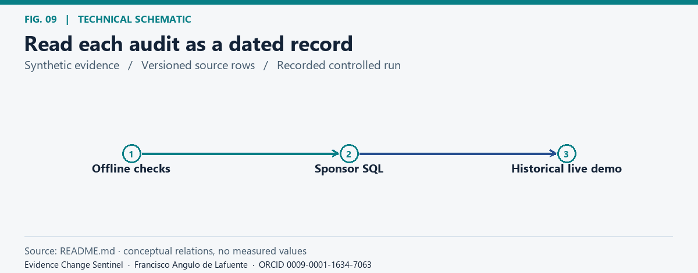

*Read each audit as a dated record.* [Static figure](docs/figures/fig-09.png).


29/29 application tests pass. The previous clean-install audit also passed 13/13 H-MEM checks, 55/55 synthetic cases, the Docker sample HTTP workflow and npm dependency auditing with zero known vulnerabilities. The acceptance gate rejects all-abstention runs and verifies each controlled outcome and its exact evidence. Real Zetaris SQL and the versioned view now pass. The complete real sponsor feature now passes on the controlled synthetic fixture; the original failed receipts remain as history. The connected demonstration and deck were submitted in HackOS; see the delivery receipt above. Historical receipts are retained rather than rewritten.

### Historical Zetaris milestone, 22 October 2026, 18:41 UTC

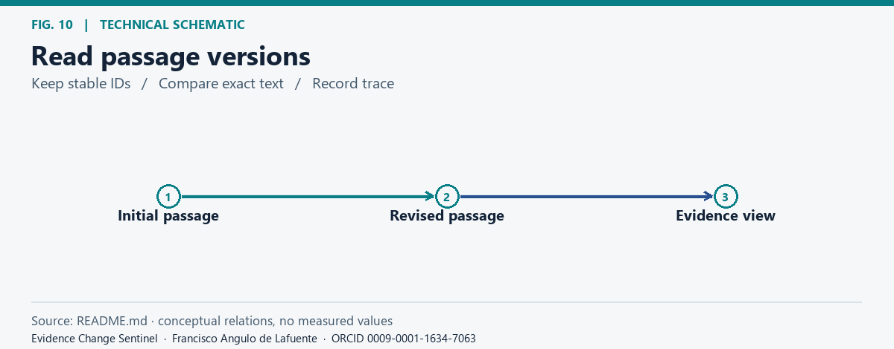

*Read passage versions.* [Static figure](docs/figures/fig-10.png).


The official local Docker stack is installed and isolated on localhost. Its REST API executed SELECT 1 and the application adapter read six exact fixture rows from `sentinel_review.sentinel_passages`, unioning two separately registered CSV sources. Authentication used an existing local user session bearer in a temporary child environment; no permanent API key is published or claimed. The official installer verification passes 8/9 checks while its optional example-data bootstrap is still running. Combined acceptance fails because Nightshift currently has no responding Runtime; earlier it reported no configured provider. This remains an unsubmitted prototype. [Detailed receipt](evidence/zetaris-20261022.json).

### Real complete feature, 23 October 2026, 02:21 UTC

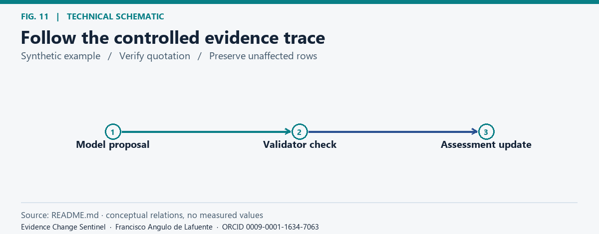

*Follow the controlled evidence trace.* [Static figure](docs/figures/fig-11.png).


[Captured result and provider receipts](evidence/live-feature-20261023.json): actual Zetaris rows, four fresh Nightshift responses from Llama 3.2 1B, independent quotation/value validation, four H-MEM records, one changed assessment, two preserved, zero abstentions. Every captured response reports local-only execution and actual cost $0. The narrow rule grammar remains a limitation; this is not independent real-world accuracy. Output schemas avoid an observed small-model input-echo failure and require separate country-code array entries. A real llama.cpp grammar failure with \d was fixed using explicit ASCII digit ranges. [CUDA placement](evidence/nvidia-local-20261023.json) records full GPU weight placement on RTX 3090 and the same PID in NVIDIA's compute-process list. No Nemotron model was used.

The official Zetaris installation check subsequently completed **9/9** after its sample bootstrap finished; the earlier 8/9 snapshot is retained as a historical receipt. All four captured receipt signatures verify with Ed25519 against the returned local daemon public key; this establishes local receipt integrity, not external organizer acceptance. The [official Build update](docs/RULE_UPDATE_20261022.md) makes Cursor optional. Codex was used. HackOS delivery subsequently succeeded at 07:06:59 UTC; the delivery receipt above records the identifier and readback. No organizer eligibility acceptance is claimed.

### Submission materials, 23 October 2026

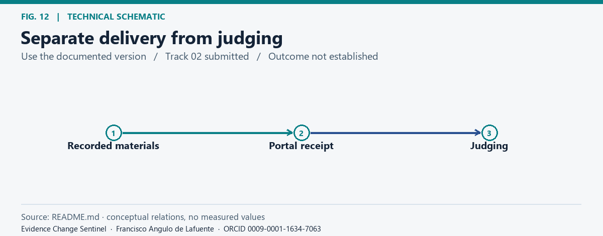

*Separate delivery from judging.* [Static figure](docs/figures/fig-12.png).


- [3:41 narrated live-feature demonstration](deliverables/evidence-change-sentinel-live-demo.mp4): real connected-workflow browser captures and slides, with synthetic narration. This is a narrated capture sequence, not an uninterrupted screen recording.
- [Eight-slide live-feature deck](deliverables/evidence-change-sentinel-live-v3.pptx).
- [Prepared description](docs/submission-description.md), [judge questions](docs/judges-qa.md) and [official coding-tool update](docs/RULE_UPDATE_20261022.md).

The prototype deck and offline video remain historical artifacts. These new files were delivered in the Track 02 submission. The receipt records the server-assigned identifier; organizer eligibility/judging remains pending.

## Bibliography and research directions

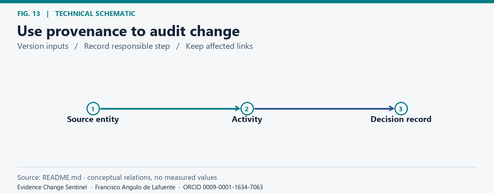

*Use provenance to audit change.* [Static figure](docs/figures/fig-13.png).


The following primary sources inform proposed checks. Their text, code, figures, and data are not included in this documentation update.

- [W3C (2013), PROV-O: The PROV Ontology](https://www.w3.org/TR/prov-o/). Represent a changed source and each reassessment as linked versions, then test that unaffected decisions retain their provenance.
- [Lewis et al. (2020), Retrieval-Augmented Generation for Knowledge-Intensive NLP Tasks](https://arxiv.org/abs/2005.11401). For model-assisted proposals, compare quoted-source support with and without retrieval on the same fixtures.

**Attribution and reuse.** Please credit [Francisco Angulo de Lafuente](https://orcid.org/0009-0001-1634-7063) in academic and software reuse and do not present this work as your own. The new figure renderer is MIT-licensed; the existing snapshot retains its original terms. When distributing copies or substantial portions of MIT software, preserve the copyright and permission notice. Upstream material keeps its own terms. [License](LICENSE.docs-renderer) · [Figure methods and provenance](docs/figures/README.md).

<!-- research-provenance: project=evidence-change-sentinel; date=2026-11-04; author=Francisco Angulo de Lafuente; orcid=https://orcid.org/0009-0001-1634-7063; new-renderer-license=MIT -->

<!-- author-background:start -->
## Author background

**Francisco Angulo de Lafuente**, independent AI researcher · [ORCID](https://orcid.org/0009-0001-1634-7063) · [arXiv](https://arxiv.org/a/angulodelafuente_f_1.html) · [Google Scholar](https://scholar.google.com/citations?user=6nOpJ9IAAAAJ) · [ResearchGate](https://www.researchgate.net/profile/Francisco-Angulo-Lafuente-3) · [Figshare](https://figshare.com/authors/Francisco_Angulo_de_Lafuente/22601234) · [Wikipedia](https://es.wikipedia.org/wiki/Francisco_Angulo_de_Lafuente)

Earlier research at ECOFA focused on biotechnology for clean energy and on second-generation biofuels obtained by microbiological processing of organic waste. Two Spanish patents document that work:

- **ES 2273594 B1**, *Process for obtaining fuels from organic waste*. Filed 5 September 2005, grant published 16 February 2008. [OEPM](https://www.oepm.es/pdf/ES/0000/000/02/27/35/ES-2273594_B1.pdf) · [Google Patents](https://patents.google.com/patent/ES2273594B1/en)
- **ES 2341194 B1**, *Method for obtaining paraffin by a biological process with microorganisms from organic matter, and its refining for use as fuel*. Filed 11 September 2007, grant published 26 April 2011. Also published as EP2196519 and WO2009034217. [OEPM](https://www.oepm.es/pdf/ES/0000/000/02/34/11/ES-2341194_B1.pdf) · [Google Patents](https://patents.google.com/patent/ES2341194B1/en)

These are historical publication and grant records under the inventor name Francisco Angulo Lafuente, and both have since lapsed. They are cited as evidence of a research trajectory and make no statement about current enforceability.
<!-- author-background:end -->
