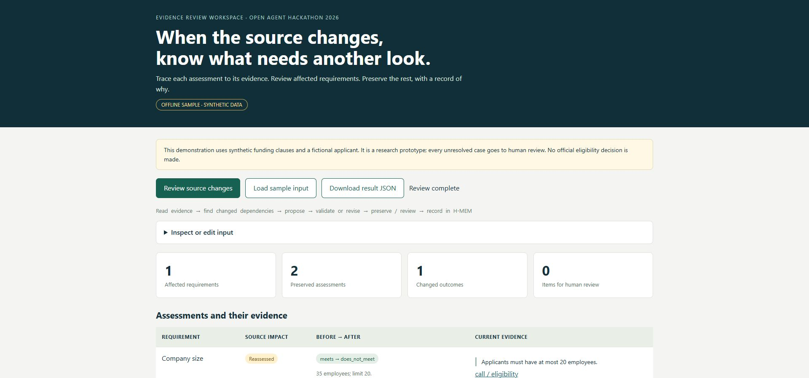
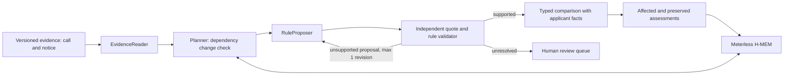

# Evidence Change Sentinel

A funding-call evidence review prototype: when a source passage changes, identify the affected assessments, quote the evidence, preserve unaffected assessments and queue uncertainty for human review.

**Status, 23 October 2026:** the real local Zetaris / Meterless Nightshift feature is **verified with synthetic evidence**: four new local-model responses, three validated requirements, one changed assessment and two preserved assessments. H-MEM records provenance. Cursor development and the final video/deck remain pending. This is not a completed hackathon submission. The offline path is deterministic, not an autonomous LLM demonstration. It does not determine official eligibility.



## Run from a clean checkout

Requires Node.js 22 or later and npm; no Python, GPU, model download or service credentials are needed for sample mode.

```sh
npm ci
npm test
npm run conformance
npm run evaluate
npm start
```

Open `http://127.0.0.1:8788`. Click **Review source changes**. Example 1 changes a company-size limit from 50 to 20: a fictional applicant with 35 staff stops meeting that criterion, while its date and region assessments are preserved. Example 2 has unchanged evidence. Example 3 introduces ambiguous wording and requires human review.

Programmatic execution:

```sh
node --import tsx run.mjs run input_examples/example_1.json output.json
```

HTTP:

```sh
curl -X POST http://127.0.0.1:8788/run \
  -H "Content-Type: application/json" \
  --data-binary @input_examples/example_1.json
```

Three inputs and their actual generated outputs are in `input_examples/` and `output_examples/`. A run writes a factual JSONL execution record under `logs/`. No private internal reasoning or credentials are logged. Inputs are limited to 500 KB over HTTP, 100 requirements and 500 versioned passages.

Optional Docker path (Docker daemon required; **built and HTTP-tested in isolation on 22 October 2026, sample mode only**):

```sh
docker build -t evidence-change-sentinel .
docker run --rm -p 127.0.0.1:8788:8788 evidence-change-sentinel
```

## What the workflow actually does



These names are software responsibilities, not claims that several autonomous agents ran in sample mode. The offline proposer interprets a deliberately narrow grammar. The live proposer calls Meterless Runtime; its validator can reject a proposal, request one repair and abstain after two failed attempts. That live loop is covered by mock contract tests and a separate actual authenticated Zetaris/Nightshift run; see `evidence/live-feature-20261023.json`. Structured JSON output constrains syntax and value types; the independent source validator still decides whether a proposal is supported. The run has a five-minute application budget and each model request is capped at the remaining budget, up to 180 seconds. An upstream outage returns an explicit error; it never masquerades as a live successful sample run.

An assessment is tied to source ID, passage ID, exact quotation, source URL and SHA-256 of the passage. Changed applicant facts also invalidate a conclusion. Missing referenced passages and new unmapped clauses trigger review. Changed clauses with unrelated content are not guessed away. No entire document is represented as unchanged simply because one old requirement still matches.

H-MEM stores assessments with provenance, source fingerprints and a mutation ledger. It is the real, unmodified upstream reference, including its deterministic hash embedder and JSON persistence. Reuse requires an exact fingerprint of project, applicant, requirement, text, URL and sample/live mode; semantic similarity alone never authorizes reuse. The CLI starts each run in a fresh memory by default; the library's `persistDir` option enables persistence and is tested across sessions. This prototype is single-process and its JSON persistence is not a concurrent multi-user database.

## Sponsor integration and remaining work

| Technology | Implemented role | Verified status |
|---|---|---|
| Meterless H-MEM | Assessment provenance, exact evidence recall, supersession and ledger | Reference conformance 13/13; application persistence test passes |
| Meterless Nightshift | OpenAI-compatible rule proposals, discovery, authentication and review feedback | Real local Llama 3.2 1B proposals and complete controlled feature pass; signed provider envelopes retained in evidence/live-feature-20261023.json |
| Zetaris | SQL retrieval from one view joining versioned call and notice evidence | Real authenticated SELECT 1 and six versioned view rows verified; see evidence/zetaris-20261022.json |
| Cursor | Required development environment | Cursor 3.2.11 and official Windows CLI located; account login requires human verification; development proof remains pending; Codex assisted |
| NVIDIA | CUDA acceleration for Nightshift local inference on RTX 3090 | Real lane placement and GPU process verified; no Nemotron special-prize claim |

### Live setup

Use `.env.example` as a list of variable names; keep credentials in your own local environment. Node 22 can read a private env file:

```sh
node --env-file=.env --import tsx scripts/preflight.mjs
node --env-file=.env --import tsx run.mjs serve
```

For live mode set `SAMPLE_MODE=false`. Supply a Zetaris instance, organisation ID and API key; a Nightshift URL, **real** Runtime token and discovered routing mode. The application does not create accounts, activate paid plans, generate keys, read the Nightshift token file or accept service terms for you. Any NVIDIA key belongs in Nightshift's Providers settings, not in this repository or in a submission.

Zetaris view `sentinel_review.sentinel_passages` must return five string columns in this order:

```sql
SELECT source_id, version, passage_id, passage_text, source_url
FROM sentinel_review.sentinel_passages
```

`version` is `before` or `after`; identities must be unique. Live mode reads these rows from Zetaris rather than trusting the input's sample rows. This view should combine the call and official notices, retain stable passage identifiers and expose both versions. Populate it with public or explicitly synthetic data; keep private applicant data outside the public repository. Fewer than 1000 rows are accepted; this prototype refuses a possibly truncated result. The audited local view unions separate synthetic calls and notices tables. Reproduce it with `docs/zetaris-provision.sql` and `data/zetaris/`, copied to the installation shared path shown in that SQL. It creates new objects and does not replace existing views.

The adapter uses the REST shape in the official 21 October Participant Setup Guide: `POST /api/v1.0/sql-editor/sqls/run`, bearer token, `X-Org-ID`, `X-Request-ID`, `queryId`, `sql`, `source`, `limit`. Meterless implements the [official Runtime provider contract](https://meterless.ai/engines.html): normalized `/v1`, model discovery, bearer authentication, `meterless-app`, `meterless-scope`, and distinct unauthorized/offline errors. `meterless/auto` is a routing mode, not proof that Nemotron executed anything.

Run `npm run preflight` with the configured environment, then an actual live example and verify quotes, traces and the Nightshift model receipt. The latest preflight verifies both endpoint connections and six Zetaris rows; `submission_ready:false` remains explicit. A separate fail-closed script, `node --env-file=.env --import tsx scripts/live-acceptance.mjs`, demands a real authenticated SQL query, a populated versioned view, Nightshift model discovery, an actual model proposal, evidence validation and H-MEM writes. Mock-backed tests are explicitly distinct from that live check.

## Hackathon demonstration and live acceptance

- [3-minute narrated **offline-prototype** video](deliverables/evidence-change-sentinel-offline-demonstration.mp4), composed of screenshots captured by a real automated browser run on the sample application. **This is not the required live sponsor demonstration, and is not a completed HackOS entry.**
- [8-slide prototype presentation](deliverables/evidence-change-sentinel-prototype.pptx), labelled as an interim deck.
- [Step-by-step sponsor acceptance and HackOS delivery gates](docs/FINAL_ACCEPTANCE_AND_SUBMISSION.md).
- For real authenticated sponsor testing: `npm run preflight` and `npm run live:accept` after loading private credentials, e.g. `node --env-file=.env --import tsx scripts/live-acceptance.mjs`.
- When the code or sample harness reports `mode: "live"` it may still be using **mocked** providers injected by tests. Only authenticated acceptance plus independently inspected sponsor receipts establishes actual Zetaris / Meterless integration.

## Evidence and evaluation

- 29 application tests: dependency invalidation, missing/added evidence, applicant changes, abstention, invented quotes, source instructions as data, bounded repair, time budgets, failure reporting and H-MEM persistence. Adapter checks use a **local mock service**, never a claimed sponsor endpoint.
- Upstream H-MEM conformance: 13/13 checks.
- `npm run evaluate`: 55 controlled synthetic cases; correct expected outcomes in all 55 and preservation of unaffected criteria. This measures the documented grammar and change propagation only. It is not independent, natural-language, real-world, legal or model-quality validation.
- `evidence/evaluation.json`: every case and its expected/actual label. `evidence/preflight.json`: current live blockers. `output_examples/`: actual results. `evidence/demo-screen.png`: browser screenshot of the offline workflow.

## Limitations

Only exact English clauses for employee limits, ISO dates and two-letter region lists are automatically interpreted. Unknown wording, exceptions, cross-references, jurisdiction-specific interpretation, time-of-day deadlines and missing facts require human review. Full extraction from arbitrary PDFs, Spanish BOE calls, source crawling, source authority verification and robust segmentation are future work. Source URLs are provenance supplied by the caller; the prototype does not certify their authenticity. Synthetic URLs use `example.org` and are not real funding notices. Adding, removing or changing unmapped passages is detected; silently dropping a requirement from the input contract is not independently detected.

Do not deploy the unauthenticated local HTTP demo to the public Internet. It binds to localhost by default; Docker users should publish only to localhost. Memory/logs are local research artifacts. No automatic application, legal advice or real funding decision is performed.

## Provenance and rights

Project concept, team description and pre-event planning existed before the build window and must be declared. The application source in this snapshot was newly authored on 22 October 2026, after the published build-window opening. No code was copied from other local product projects. Synthetic fixtures were authored for this build.

Meterless H-MEM is a declared pre-existing third-party dependency, vendored from [Meterless/Meterless](https://github.com/Meterless/Meterless) commit `1742dec56a66e58eef9dda2d2b865823758ca8cd`. Its Apache 2.0 licence and provenance are retained under `vendor/hmem/`. tsx and its dependencies retain their package licences. The original application is provided as a research submission snapshot; no additional third-party code rights are implied.

For hackathon rules and the current deadline use the [official event page](https://hackathon.genai.works/event/open-agent-hackathon-2026). The local package is not evidence of a submitted or accepted entry.

## Audit checkpoint: 22 October 2026

29/29 application tests pass. The previous clean-install audit also passed 13/13 H-MEM checks, 55/55 synthetic cases, the Docker sample HTTP workflow and npm dependency auditing with zero known vulnerabilities. The acceptance gate rejects all-abstention runs and verifies each controlled outcome and its exact evidence. Real Zetaris SQL and the versioned view now pass. The complete real sponsor feature now passes on the controlled synthetic fixture; the original failed receipts remain as history. Cursor use and the final sponsor-connected video/deck remain pending. Historical receipts are retained rather than rewritten.

### Historical Zetaris milestone, 22 October 2026, 18:41 UTC

The official local Docker stack is installed and isolated on localhost. Its REST API executed SELECT 1 and the application adapter read six exact fixture rows from `sentinel_review.sentinel_passages`, unioning two separately registered CSV sources. Authentication used an existing local user session bearer in a temporary child environment; no permanent API key is published or claimed. The official installer verification passes 8/9 checks while its optional example-data bootstrap is still running. Combined acceptance fails because Nightshift currently has no responding Runtime; earlier it reported no configured provider. This remains an unsubmitted prototype. [Detailed receipt](evidence/zetaris-20261022.json).

### Real complete feature, 23 October 2026, 02:21 UTC

[Captured result and provider receipts](evidence/live-feature-20261023.json): actual Zetaris rows, four fresh Nightshift responses from Llama 3.2 1B, independent quotation/value validation, four H-MEM records, one changed assessment, two preserved, zero abstentions. Every captured response reports local-only execution and actual cost $0. The narrow rule grammar remains a limitation; this is not independent real-world accuracy. Output schemas avoid an observed small-model input-echo failure and require separate country-code array entries. A real llama.cpp grammar failure with \d was fixed using explicit ASCII digit ranges. [CUDA placement](evidence/nvidia-local-20261023.json) records full GPU weight placement on RTX 3090 and the same PID in NVIDIA's compute-process list. No Nemotron model was used.

The official Zetaris installation check subsequently completed **9/9** after its sample bootstrap finished; the earlier 8/9 snapshot is retained as a historical receipt. All four captured receipt signatures verify with Ed25519 against the returned local daemon public key; this establishes local receipt integrity, not external organizer acceptance. Cursor authentication, final presentation/recording and HackOS delivery remain open gates. No submission ID or acceptance is claimed.
