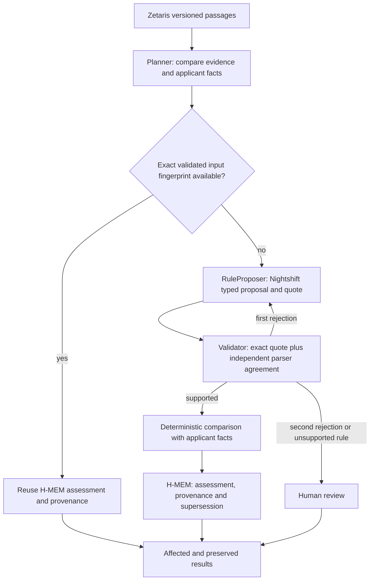

# Model proposals, validation and evidence reuse

This describes the submitted three-grammar implementation and its dated
23 October connected run. It does not claim a new live run on 26 October.
See [current service recovery](OPERATIONS.md) for today's limitations.

## What does the model decide beyond the parser?

**No additional eligibility rule is authorized by the model.** In the submitted
implementation, `checkProposal` accepts a proposal only when its kind and value
match `extractRule`, and its nonempty quote is an exact source substring. The
typed comparison with applicant facts is deterministic. A correct model reading
of unsupported wording, such as a number written as a word, still goes to human
review when the grammar cannot independently validate it.

The live model generates a typed proposal and a proposed quote. It may fail,
abstain, or revise after validator feedback. Its failure can therefore prevent an
automatic assessment, but it cannot widen the supported rules or override the
validator. One repair is allowed; two rejected attempts cause human review.
The offline path bypasses the model and uses the deterministic parser. Passing
the offline synthetic evaluation is not evidence that the model improves accuracy
or contributes independent reasoning. That comparison has not been measured.

## Workflow and reuse conditions

The first run assesses the before version of each requirement. A relevant change
then invalidates that dependency and evaluates the after version. Unaffected
assessments are preserved only if both passage text/URL and applicant facts are
unchanged. Reusing an existing H-MEM record also requires an exact fingerprint
of project, applicant, requirement, passage text, source URL and sample/live mode.
Semantic similarity alone does not authorize reuse. A changed applicant can
invalidate a decision even when its passage did not change. Old/new assessments
are linked with supersedes/supersededBy, rather than silently overwriting history.

Planner, RuleProposer, Validator and MemoryWriter are named software roles. The
live RuleProposer invokes an actual model; scheduling, validation, assessment and
memory operations are programmed logic. Multiple autonomous model agents are
not claimed.

## Model per request in the recorded run

[The derived trace index](../evidence/model-request-index-20261023.json) links each
of the four `propose_rule` events to its captured request ID, actual routed model
and receipt ID. It was derived on 26 October from the unchanged
[23 October capture](../evidence/live-feature-20261023.json), not from new calls.
The matching checks serial call order and the unique rule/quote against the
corresponding previous/current result. This is an explicit derived association;
the original trace did not log request IDs or models at event creation time.

All four winning routes name `local-runtime/llama-3.2-1b-instruct`, and all four
captured responses report `from_cache:false`. Other model names in the receipt's
cost-comparison fields are baselines, not executed routes. Receipt signatures
verify against a public key returned by the same local daemon; this is a local
integrity check, not independent identity or organizer approval.

## Sponsor roles and boundaries

| Component | Working role in the recorded feature | Boundary |
|---|---|---|
| Zetaris | One SQL view combines versioned synthetic call and notice passages from separate registered sources | A six-row controlled fixture, not unrestricted real-world call extraction |
| Meterless Nightshift | Four authenticated local-model proposals, with provider receipts and one bounded validation/repair loop | No model-only eligibility decision or model-quality improvement established |
| Meterless H-MEM | Exact-fingerprint reuse, evidence provenance and linked supersession history | Real attributed upstream engine; semantic similarity is not sufficient for reuse |
| NVIDIA CUDA | Local RTX 3090 inference in the dated recording | No Nemotron model or special-award entitlement claimed |

The distinctive composition is versioned SQL evidence tied to exact validated
memory fingerprints: a change invalidates only its dependencies while preserving
unaffected assessments and their provenance. This is a demonstrated implementation
property, not a claim of research novelty or superior accuracy.

All delivered funding clauses and applicant facts are synthetic. No real public
call has been evaluated. Spanish BOE calls, arbitrary PDF extraction and broader
legal interpretation remain outside this version. Adding a real notice without
a faithful source-to-input transformation and human labels would not establish
real-world accuracy, so no such claim is added during final communications.
